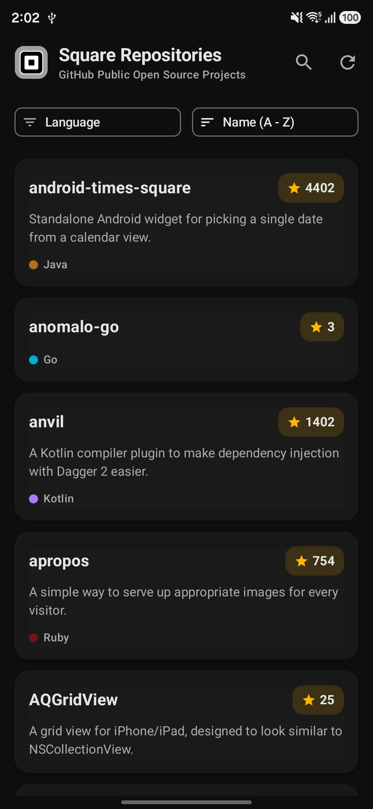
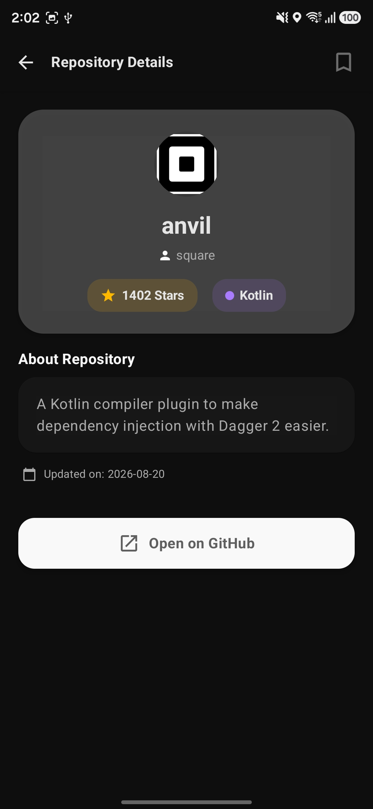
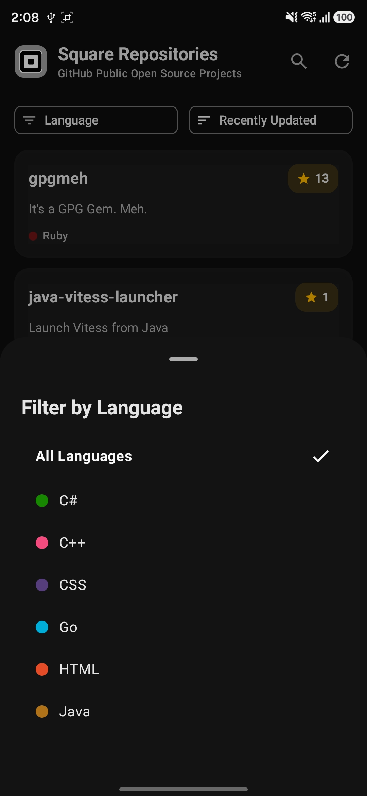
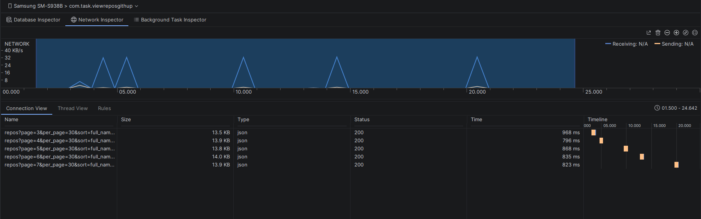
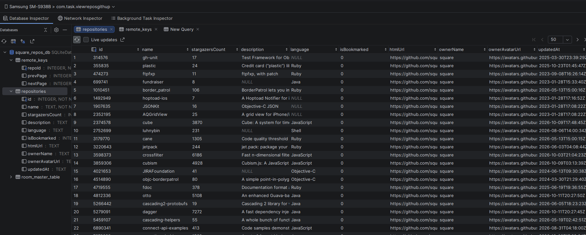
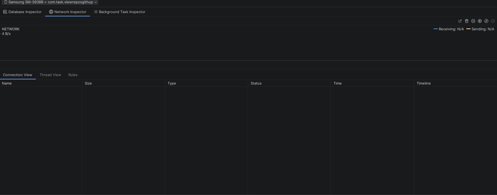

# 🚀 Square Repositories – Modern Android Architecture Showcase

[](https://developer.android.com/about/versions/15)
[](https://kotlinlang.org)
[](https://developer.android.com/topic/architecture)
[](LICENSE)

A production-ready, highly polished Android application built to demonstrate **Modern Android Development (MAD)** best practices. It fetches, filters, and caches GitHub repositories for Square Inc., delivering an offline-first experience with seamless pagination, type-safe navigation, and state-of-the-art UI performance.

---

## 📸 Screenshots & Video Demo

| Repository List | Details Screen | Dark Mode / Filter |
| :---: | :---: | :---: |
|  |  |  |

### 🎬 Watch the App Demo
[](https://www.youtube.com/shorts/ucgloE0Bbuc)

---

## ✨ Key Features & Architectural Highlights

- **🏛 Clean Architecture & MVI/MVVM:** Strict separation of concerns into `data`, `domain`, and `ui` layers.
- **🔄 Unidirectional Data Flow (UDF):** Immutable StateFlow combined with unified `UiState` data classes (`RepoListUiState` & `RepoDetailsUiState`) for single-source-of-truth reliability.
- **🔀 Type-Safe Navigation (Navigation 2.8+):** Powered by `kotlinx.serialization` to eliminate compile-time string route errors and boilerplate argument parsing.
- **⚡ Offline-First with Paging 3 & RemoteMediator:** Seamless database caching with Room, allowing smooth paginated browsing without network interruptions.
- **🎨 Performance-Optimized Compose UI:**
  - **State Scope Isolation:** Search state (`searchQuery`) is isolated to prevent whole-screen recompositions during typing.
  - **Fluid Animations:** Polished entrance transitions (`fadeIn`, `slideInVertically`) and micro-interactions.
- **💉 Modern Dependency Injection:** Fully decoupled modules powered by **Hilt**.
- **🧪 Complete Unit Test Suite:** High coverage for ViewModels and Use Cases using **MockK**, **Turbine**, and **Coroutines Test Dispatchers**.

---

## 🛠 Tech Stack & Libraries

- **Language:** [Kotlin](https://kotlinlang.org/)
- **UI Framework:** [Jetpack Compose](https://developer.android.com/jetpack/compose) with Material 3 Design
- **Architecture & Lifecycle:** ViewModel, StateFlow, Coroutines, SavedStateHandle
- **Navigation:** Jetpack Navigation Component (Type-Safe 2.8+)
- **Dependency Injection:** [Hilt](https://dagger.dev/hilt/)
- **Network Layer:** [Retrofit](https://square.github.io/retrofit/) + OkHttp3 + Gson
- **Persistence & Caching:** [Room Database](https://developer.android.com/training/data-storage/room) + Paging 3 (RemoteMediator)
- **Image Loading:** [Coil](https://coil-kt.github.io/coil/)
- **Serialization:** Kotlinx Serialization
- **Testing:** JUnit5, MockK, Turbine, Kotlinx Coroutines Test

---
## ⚡ Offline-First Architecture & Caching Mechanism

### 1. First Launch (Network Fetch & Pagination)
When the application is opened for the first time, network requests are sent to fetch data using Paging 3.
<br>


---

### 2. Local Database Caching
Store and save data locally within a Room database to serve as the single source of truth:
<br>


---

### 3. Subsequent Launches (Zero Network Requests)
Upon subsequent launches of the app, data is loaded immediately without making any new network requests:
<br>



---

## 📐 Architecture Overview

                      ┌───────────────────────┐
                      │   UI Layer (Compose)  │
                      └───────────┬───────────┘
                                  │ Observes State / Emits Events
                                  ▼
                      ┌───────────────────────┐
                      │    UI State / ViewModel│
                      └───────────┬───────────┘
                                  │ Invokes
                                  ▼
                      ┌───────────────────────┐
                      │      Domain Layer     │
                      │(UseCases & Interfaces)│
                      └───────────┬───────────┘
                                  │ Implemented by
                                  ▼
                      ┌───────────────────────┐
                      │       Data Layer      │
                      │(Room DB, Retrofit, PM)│
                      └───────────────────────┘

                      ---

## 🧪 Running Unit Tests

To run the full suite of unit tests, execute the following Gradle command:

```bash
./gradlew testDebugUnitTest
